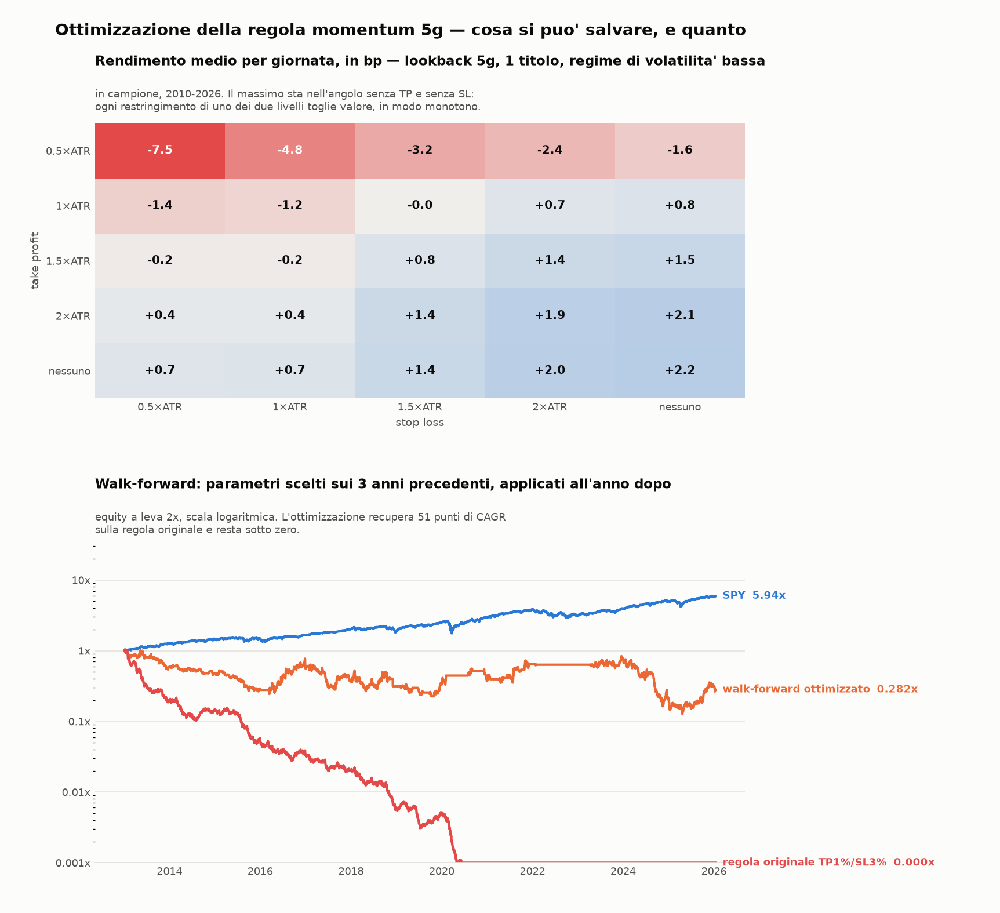

# Falle del backtest e ottimizzazione dei parametri

Seguito di `MOMENTUM_RESULTS.md`. Due domande: **dove i numeri possono rompersi**, e
**se esiste una configurazione che salva la regola**.

```
python3 momentum_engine.py   DATA                 # verifica che il motore veloce = motore lento
python3 momentum_audit.py    --data DATA          # le falle, quantificate
python3 momentum_optimize.py --data DATA          # walk-forward su 1500 configurazioni
python3 momentum_opt_chart.py --data DATA --out momentum_opt.png
```

Output completi: `momentum_audit.txt`, `momentum_optimize.txt`.



---

# Parte 1 — Le falle

Ordinate per quanto sposterebbero la conclusione. Le prime tre contano davvero.

## 1.1 L'edge del segnale regge, ma non regge ai costi — e un terzo è solo beta

Questa è la verifica più importante, perché tutto il resto dell'analisi si appoggia al
fatto che il segnale nudo renda +9,8 bp al giorno.

| test | risultato |
|---|---|
| t-stat ingenuo (iid) | +2,69 |
| errore standard clusterizzato per titolo | **+3,55** |
| block bootstrap, blocchi 20g, 5000 ripetizioni | IC95% **[+3,1 ; +16,7] bp**, P(media≤0) = 0,2% |
| togliendo TSLA, AMD, NFLX (i 3 titoli più pescati) | +8,6 bp, t +2,40 |
| anni con media positiva | 15 su 17 |
| prima metà / seconda metà del campione | +11,9 / +7,8 bp |

L'edge **non** è un artefatto statistico: sopravvive al clustering, al bootstrap a blocchi
e alla rimozione dei titoli dominanti. Ma:

- **Regressione sul mercato** (SPY apertura→chiusura dello stesso giorno): **beta 1,04**,
  **alfa +7,4 bp**, t(alfa) +2,17. Dei 9,8 bp, **2,4 sono semplice esposizione al mercato**:
  il top performer è per costruzione un titolo ad alto beta.
- L'andata-ritorno retail costa ~8 bp. **L'alfa netto è ≈ −0,6 bp.** L'intervallo di
  confidenza parte da +3,1 bp, cioè include valori ampiamente sotto la soglia dei costi.

Questa è la falla vera: non "il backtest sbaglia", ma "l'edge misurato sta dentro la
barra d'errore dei costi", e dichiararlo sfruttabile sarebbe ingiustificato.

## 1.2 Una parte dello spazio dei parametri non è decidibile con barre giornaliere

Percentuale di giorni in cui il minimo tocca lo stop **e** il massimo tocca il target —
cioè in cui le barre daily non sanno dire chi è scattato prima:

| | SL 1% | SL 2% | SL 3% | SL 5% |
|---|---|---|---|---|
| **TP 0,5%** | 34,6% | 16,4% | 8,0% | 2,6% |
| **TP 1%** | 21,7% | 9,4% | **4,6%** | 1,4% |
| **TP 2%** | 9,7% | 3,8% | 2,0% | 0,7% |
| **TP 3%** | 4,7% | 1,8% | 0,8% | 0,3% |

Le barre orarie coprono solo dal 2023-10 (yfinance non va oltre 730 giorni sull'intervallo
60m). Su TP e SL stretti, **ottimizzare su barre giornaliere significa ottimizzare
l'ipotesi sul percorso, non la strategia**. Nella sezione ottimizzazione questa regione è
esclusa esplicitamente in un secondo passaggio (cambia poco, perché l'ottimo scappa
comunque verso livelli larghi).

## 1.3 Le ipotesi di esecuzione sono ottimistiche, e contano

**a) Il take profit è assunto eseguito se il massimo lo sfiora.** In un book reale servono
ordini davanti a te:

| condizione | CAGR | media/trade |
|---|---|---|
| basta toccare il livello (ipotesi del backtest) | −63,5% | −17,7 bp |
| serve superarlo di 5 bp | −65,8% | −18,9 bp |
| serve superarlo di 10 bp | −68,8% | −20,8 bp |
| serve superarlo di 25 bp | −74,2% | −24,6 bp |

**b) Lo slippage è piatto in bp, mentre nella realtà scala con la volatilità del titolo.**
E questa strategia compra per costruzione i titoli più agitati del giorno:

| slippage in ingresso | CAGR | media/trade |
|---|---|---|
| 3 bp piatti (il backtest) | −63,5% | −17,7 bp |
| + 2% dell'ATR (~4 bp su ATR 2%) | −78,1% | −27,5 bp |
| + 5% dell'ATR (~10 bp) | −90,7% | −44,0 bp |
| + 10% dell'ATR (~20 bp) | −97,9% | −72,5 bp |

Entrambe le falle spingono **nella stessa direzione**: il risultato vero è peggiore di
quello riportato, non migliore.

## 1.4 Il backtest compone anche dopo che il conto sarebbe stato chiuso

| | sotto il 50% del capitale | sotto il 10% |
|---|---|---|
| leva 1x | 2010-11-18 | 2013-06-05 |
| leva 2x | 2010-05-04 | 2011-08-10 |

Peggior giornata a 2x: −6,2%; 628 giornate con perdita oltre il 5%. Con margine di
mantenimento al 25%, la chiamata a margine arriva molto prima della fine del campione.
**Le equity finali a `0,000x` vanno lette come "conto azzerato nel 2011", non come un
numero da confrontare.** Questo non cambia il segno della conclusione, ma rende senza
senso ogni confronto fra CAGR molto negativi.

## 1.5 Dati: una fonte sola, rettifiche retroattive, spin-off non gestiti

- 1,60% di celle mancanti; 2 variazioni giornaliere oltre il 50% residue dopo la rettifica.
- Una delle due è **DHR il 2016-07-05 (+61%): è lo scorporo di Fortive.** Yahoo rettifica
  dividendi e split, **non gli spin-off**: quel giorno il titolo risulta top performer per
  un evento che non è un rendimento.
- Effetto misurato: 26 trade su 4183 hanno nella finestra un salto giornaliero >30%, e
  rendono **−54,3 bp** contro +10,2 bp degli altri. La contaminazione esiste, è piccola e
  va **contro** la strategia: non è lei a creare l'edge.
- I prezzi rettificati vengono riscritti a ogni nuovo dividendo: **lo stesso backtest
  rifatto fra un anno non darà esattamente questi numeri.**
- **Survivorship bias**: universo = membership odierna dell'S&P 100. Direzione nota
  (gonfia), entità non misurabile senza la composizione storica dell'indice.

## 1.6 Attriti non modellati, tutti a sfavore

Tasse (un trade al giorno è reddito da negoziazione, non capital gain di lungo periodo —
il precedente `swing_harness.py` modellava un 33% irlandese, qui no); halt di volatilità
LULD, dentro i quali uno stop non viene eseguito al prezzo; il prezzo d'asta di apertura
assunto ottenibile mentre il proprio ordine lo muove; regola PDT (sotto i 25.000$ di conto
questa strategia negli USA non è eseguibile). La **capienza invece non è un vincolo**: il
titolo scelto ha un dollar volume mediano di 829 M$ al giorno.

---

# Parte 2 — Ottimizzazione

## 2.1 Metodo

Griglia di **1500 configurazioni**:

| dimensione | valori |
|---|---|
| periodo del segnale | 2, 3, 5, 10, 20 giorni |
| numero di posizioni | 1, 3, 5, 10 equipesate |
| take profit | 0,5 · 1 · 1,5 · 2 × ATR(14) del titolo, oppure nessuno |
| stop loss | 0,5 · 1 · 1,5 · 2 × ATR(14) del titolo, oppure nessuno |
| regime di mercato | sempre · SPY sopra la MA200 · volatilità SPY sotto il 60° percentile |

TP e SL in multipli di ATR sono la versione "in base all'andamento del mercato": un titolo
che oscilla il 4% al giorno e uno che oscilla l'1% non possono avere lo stesso target fisso
all'1%. Il regime aggiunge lo stato del mercato a quello del titolo.

**Walk-forward**: la configurazione si sceglie sui 3 anni precedenti e si applica all'anno
successivo senza più toccarla, poi si scorre. Conta solo la concatenazione degli anni fuori
campione. Obiettivo: Sharpe dei rendimenti giornalieri, calcolato su *tutti* i giorni (zero
quando il filtro tiene fuori dal mercato, altrimenti un filtro che sta fermo sembrerebbe
bravo solo perché opera poco). Lo Sharpe non dipende dalla leva: la leva si sceglie dopo.

Il motore vettorizzato (`momentum_engine.py`) è verificato contro quello a ciclo del primo
backtest: **4176 trade su 4176 identici, scarto massimo 8,7e-18**.

## 2.2 Risultato del walk-forward

| | Sharpe | bp/giorno | CAGR a 2x | maxDD |
|---|---|---|---|---|
| **walk-forward ottimizzato** | **+0,05** | **+0,5** | **−9,3%** | −87,5% |
| regola originale TP1%/SL3%, top 1 | −1,75 | −16,2 | −60,4% | −100% |
| configurazione a caso ogni anno | −1,28 | −8,8 | −39,7% | −99,9% |
| miglior combinazione in-sample* | +0,25 | +2,8 | −1,1% | −91,9% |

\* `lb5 · top1 · no TP · no SL · vol bassa`, massimo di 1500 tentativi misurato sullo stesso
campione su cui è stato scelto: non è un risultato utilizzabile. **Nota che nemmeno
barando si arriva sopra zero.**

**Degrado in/out of sample: Sharpe medio scelto +0,87 → realizzato −0,07.** Sette finestre
su tredici positive. È la misura di quanto la griglia stia inseguendo rumore.

L'ottimizzazione recupera **51 punti di CAGR** sulla regola originale. Non basta.

## 2.3 Qual è il periodo ottimale, e quante posizioni

Effetto marginale di ogni parametro, mediato su tutte le altre combinazioni:

**Periodo del segnale** — il 5 giorni scelto in partenza è effettivamente il migliore:

| giorni | bp/g medio | bp/g migliore |
|---|---|---|
| 2 | −6,89 | −0,69 |
| 3 | −6,85 | −1,51 |
| **5** | **−3,97** | **+2,15** |
| 10 | −4,68 | −1,03 |
| 20 | −4,02 | −0,12 |

**Numero di posizioni** — concentrare batte diversificare, perché l'edge sta solo nel
titolo di rango 1: dal secondo in poi si aggiungono costi e non segnale.

| | bp/g medio | bp/g migliore |
|---|---|---|
| **top 1** | **−4,58** | **+2,15** |
| top 3 | −5,51 | −0,90 |
| top 5 | −5,61 | −1,34 |
| top 10 | −5,43 | −2,20 |

**Regime di mercato** — l'unico filtro che aggiunge qualcosa di reale:

| | bp/g medio | bp/g migliore |
|---|---|---|
| **volatilità bassa** | **−3,30** | **+2,15** |
| SPY > MA200 | −5,98 | +1,04 |
| sempre | −6,56 | +1,82 |

## 2.4 Il risultato più netto: TP e SL non hanno un ottimo interno

| TP \ SL | 0,5×ATR | 1×ATR | 1,5×ATR | 2×ATR | nessuno |
|---|---|---|---|---|---|
| **0,5×ATR** | −7,5 | −4,8 | −3,2 | −2,4 | −1,6 |
| **1×ATR** | −1,4 | −1,2 | −0,0 | +0,7 | +0,8 |
| **1,5×ATR** | −0,2 | −0,2 | +0,8 | +1,4 | +1,5 |
| **2×ATR** | +0,4 | +0,4 | +1,4 | +1,9 | +2,1 |
| **nessuno** | +0,7 | +0,7 | +1,4 | +2,0 | **+2,2** |

(bp/giorno, lookback 5, top 1, regime di volatilità bassa, in campione)

La superficie è **monotona in entrambe le direzioni** e il massimo sta nell'angolo
"nessun TP, nessun SL". Non c'è un take profit ottimale e non c'è uno stop ottimale:
**ogni livello che si stringe toglie valore.** Coerentemente, il walk-forward sceglie
"nessuno stop" in 11 finestre su 13.

Questo vale nel contesto di una regola intraday a un giorno: lo stop non protegge da nulla
che la chiusura non chiuda comunque poche ore dopo, mentre tronca sistematicamente le
giornate che sarebbero rientrate. Su un orizzonte multi-giorno il discorso cambia.

## 2.5 Quante configurazioni superano la soglia dei costi

- Con media **> 0 bp/giorno**: 35 su 1500 (2,3%)
- Con media **> 4 bp/giorno**, cioè sopra il costo di andata e ritorno retail: **0 su 1500**

Lo Sharpe mediano della griglia è −0,82, il massimo +0,20.

## 2.6 Leva: il dimensionamento a volatilità riduce il danno, non lo inverte

| | leva media | CAGR | Sharpe |
|---|---|---|---|
| target vol 10% | 0,78x | −2,4% | −0,13 |
| target vol 15% | 0,98x | −3,3% | −0,11 |
| target vol 25% | 1,34x | −6,6% | −0,12 |
| leva fissa 2x | 2,00x | −9,3% | +0,05 |

Il CAGR migliora solo perché la leva media scende: applicare una leva qualsiasi a uno
Sharpe nullo non produce rendimento. In questo campione il vol targeting **peggiora** pure
lo Sharpe, perché deleveraggia dopo le fasi agitate che precedono i rimbalzi.

## 2.7 Stabilità dei parametri scelti

| parametro | scelte nelle 13 finestre |
|---|---|
| lookback | 5×8, 10×4, 20×1 |
| numero titoli | 1×10, 5×2, 3×1 |
| TP (×ATR) | 1,5×4 · 2,0×4 · nessuno×3 · 1,0×1 · 0,5×1 |
| SL (×ATR) | **nessuno×11**, 0,5×2 |
| regime | vol bassa×7, sempre×3, SPY>MA200×3 |

Lookback, numero di titoli e stop sono stabili. Il take profit salta da una finestra
all'altra: su quella dimensione non esiste un valore ottimale, c'è rumore.

---

# Conclusione

**Le falle non salvano la strategia, la peggiorano.** Le tre che contano — alfa netto di
beta dentro la barra d'errore dei costi, esecuzione del take profit assunta troppo
generosa, slippage che nella realtà scala con la volatilità — spingono tutte nella stessa
direzione.

**L'ottimizzazione risponde alle tre domande poste**, e la risposta è coerente con
quello che il primo backtest aveva già mostrato:

- **periodo ottimale: 5 giorni** — la scelta iniziale era giusta;
- **numero di posizioni: 1** — l'edge sta solo nel rango 1, diversificare aggiunge costi;
- **TP e SL adattivi all'ATR: l'ottimo è non metterli.** La superficie è monotona, il
  massimo sta all'angolo. Un filtro di regime (volatilità di mercato bassa) è l'unica
  aggiunta che porta valore.

Applicando tutto questo con disciplina walk-forward si passa da **−60,4% a −9,3%** di CAGR
annuo. È un miglioramento enorme e rimane una perdita, perché il vincolo non è la
configurazione: è che **zero configurazioni su 1500 producono un rendimento lordo superiore
al costo di transazione**.
