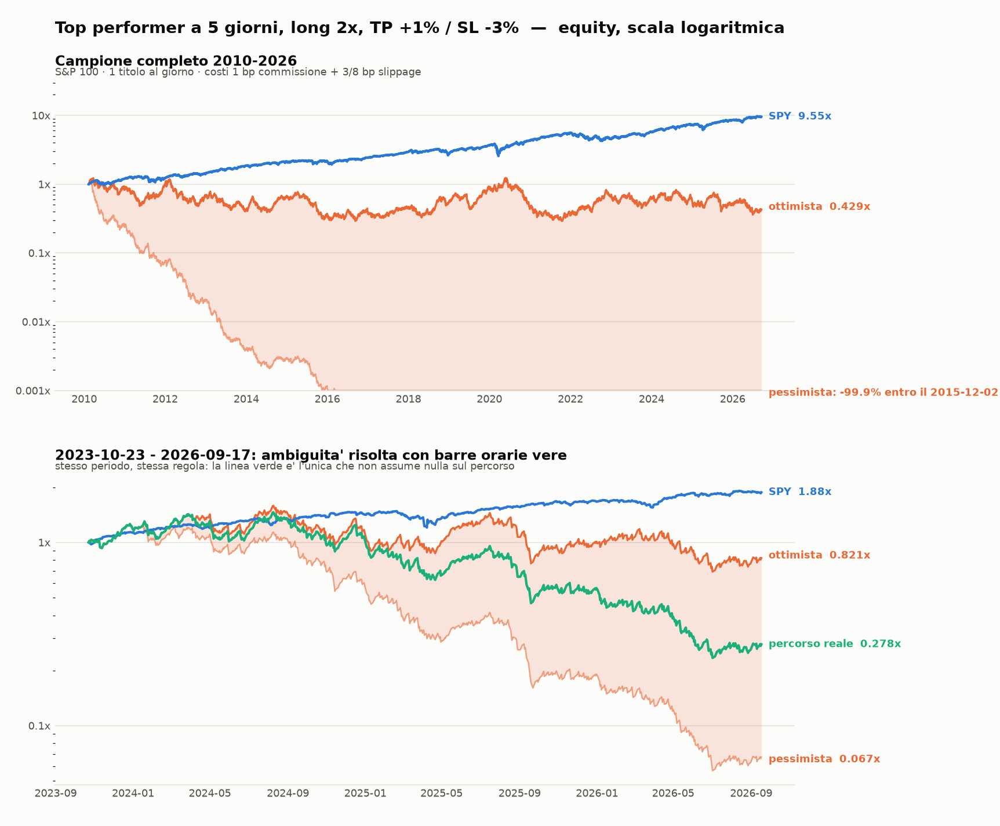

# Backtest: top performer a 5 giorni, long 2x, TP +1% / SL -3%

**Verdetto: la regola perde soldi in modo sistematico. Non e' il segnale a essere sbagliato —
e' la struttura di uscita, piu' la leva.**

Codice: `momentum_fetch.py` (dati) · `momentum_backtest.py` (motore) · `momentum_chart.py` (grafico).
Output completo: `momentum_report.txt` · grafico: `momentum_equity.png`.

```
python3 momentum_fetch.py daily    DATA  2010-01-01 2026-09-20
python3 momentum_fetch.py intraday DATA60
python3 momentum_backtest.py --data DATA --intraday DATA60 --selftest --report
python3 momentum_chart.py    --data DATA --intraday DATA60 --out momentum_equity.png
```



## Cosa e' stato testato

| | |
|---|---|
| Universo | S&P 100, 101 titoli con storico utile |
| Periodo | 2010-01-04 → 2026-09-18, 4.203 sedute, 4.176 trade |
| Segnale | `r5 = Close[t-1]/Close[t-6] - 1`, calcolato su prezzi rettificati per split e dividendi |
| Ingresso | apertura del giorno t, il titolo con r5 piu' alto |
| Uscita | TP +1% / SL -3% sul prezzo di riempimento, altrimenti in chiusura |
| Leva | 2x |
| Costi | 1 bp commissione per lato, 3 bp slippage in ingresso, 8 bp sullo stop (a mercato), TP a limite senza slippage |

## Risultato

| | equity finale | CAGR | maxDD | Sharpe | win% | media/trade |
|---|---|---|---|---|---|---|
| strategia, ipotesi pessimista | 0,000x | **−63,8%** | −100% | −1,89 | 59,2% | −17,8 bp |
| strategia, ipotesi ottimista | 0,429x | **−5,0%** | −76,3% | 0,11 | 63,8% | +0,9 bp |
| **strategia, percorso reale** (2023-2026) | **0,278x** | **−35,3%** | −84,0% | −0,70 | 64,0% | −6,4 bp |
| SPY buy & hold, 1x, senza costi | 9,549x | +14,6% | −33,7% | 0,88 | — | — |

Il 64% di operazioni vincenti e una perdita del 64% l'anno convivono benissimo: e' esattamente
cio' che produce un target piccolo con uno stop grande.

### Perche' ci sono tre righe

Con barre giornaliere, nel 4,6% dei giorni il minimo tocca lo stop **e** il massimo tocca il
target: l'ordine degli eventi non e' osservabile. Invece di scegliere l'ipotesi comoda, ho
riportato entrambi gli estremi e risolto l'ambiguita' con **barre orarie vere** (yfinance 60m,
ottobre 2023 → settembre 2026, 728 trade): 30 giorni ambigui, 23 risolti, **il TP scatta per
primo nel 74% dei casi**. Il percorso reale sta quindi molto vicino all'estremo ottimista, e
perde comunque il 35% l'anno.

## Perche' perde

### 1. Il segnale, da solo, un edge ce l'ha

Apertura → chiusura, senza TP/SL, senza costi, 1x:

| | bp/giorno | t-stat | annuo | Sharpe |
|---|---|---|---|---|
| top performer 5g | **+9,8** | 2,68 | +24,8% | 0,66 |
| media dell'universo | +2,7 | 2,21 | +6,8% | 0,54 |
| bottom performer 5g | −3,1 | −0,87 | −7,7% | −0,21 |

C'e' continuazione intraday dopo una corsa di 5 giorni, ed e' statisticamente significativa.
Il problema viene dopo.

### 2. Il TP a +1% e' dentro l'escursione tipica, lo stop a −3% e' fuori

L'escursione media intraday del titolo scelto e' **+1,71% / −1,59%**. Un target a +1% viene
quindi toccato quasi sempre nelle giornate buone (51,5% dei trade), troncando la vincita a +1%;
uno stop a −3% non tronca quasi nulla e quando scatta (14,6%) costa tre volte tanto.
Decomposizione dei 4.176 trade (ipotesi pessimista):

| esito | quota | media | contributo |
|---|---|---|---|
| TP | 51,5% | +98 bp | +50,5 bp |
| chiusura senza trigger | 33,9% | **−68,5 bp** | −23,2 bp |
| SL (incl. ambigui) | 14,6% | −310 bp | −45,1 bp |
| **totale** | | | **−17,8 bp** |

Il secondo rigo e' il meno intuitivo: quando non scatta nulla, la giornata chiude in perdita.
Il filtro TP/SL seleziona nel bucket "chiusura" proprio le giornate senza spinta.

### 3. La leva 2x aggiunge volatility drag

Anche togliendo TP e SL (si compra in apertura, si vende in chiusura), con costi retail:

```
media aritmetica netta  +1,84 bp/g    vol giornaliera 2,37%
1x:  drag 0,5·var = 2,80 bp  ->  geometrico attesa  -0,95 bp/g
2x:  aritm +3,69 bp, drag 11,19 bp  ->  geometrico attesa  -7,50 bp/g   (-17% l'anno)
```

Un singolo titolo con 2,37% di volatilita' giornaliera, preso a leva 2x, ha un drag da varianza
di 11 bp al giorno. L'edge lordo e' 9,8. La leva non moltiplica un edge di 9,8 bp: se lo mangia.

### 4. I costi si mangiano il resto

Lo stesso setup (top 1, niente TP/SL, 1x) al variare dei costi:

| costi (comm/slip-in/slip-out) | media/trade | CAGR | Sharpe |
|---|---|---|---|
| zero (irrealistico) | +9,8 bp | +19,5% | 0,66 |
| istituzionale 0,5/1/1 bp | +6,8 bp | +10,8% | 0,46 |
| retail buono 1/3/3 bp | +1,8 bp | −2,3% | 0,12 |
| retail tipico 2/8/8 bp | −10,2 bp | −27,8% | −0,68 |

Un edge da 9,8 bp al giorno richiede costi di andata-ritorno sotto i 4 bp per sopravvivere.
A leva 2x ogni bp di costo pesa il doppio.

### 5. Nessuna combinazione di TP/SL salva la regola

Stesso segnale, stessa leva 2x, stessi costi — cambia solo dove si mettono le uscite:

| uscita | CAGR pess. | CAGR ott. | win% | media/trade (pess.) |
|---|---|---|---|---|
| nessun TP/SL, chiusura | −17,0% | −17,0% | 49,3% | +1,8 bp |
| **TP +1% / SL −3%  (la regola)** | **−63,8%** | **−5,0%** | 59,2% | −17,8 bp |
| TP +1% / SL −1% | −75,2% | +140,2% | 39,6% | −26,7 bp |
| TP +2% / SL −2% | −46,1% | +17,3% | 48,3% | −9,7 bp |
| TP +3% / SL −1% (invertita) | −36,0% | +65,6% | 36,5% | −6,9 bp |
| TP +3% / SL −3% | −32,7% | −13,6% | 49,3% | −4,3 bp |
| solo TP +1% | −17,2% | −17,2% | 63,9% | −1,3 bp |
| solo SL −3% | −12,3% | −12,3% | 48,6% | +2,1 bp |

Le righe con una forchetta larga fra pessimista e ottimista (TP e SL entrambi stretti) sono
quelle in cui le barre giornaliere non bastano a dire nulla: il 21,7% di giorni ambigui della
riga TP1/SL1 significa che quel +140% e' un artefatto dell'ipotesi, non un risultato.
La riga onesta e' l'ultima: **l'unico ingrediente che non distrugge valore e' lo stop da solo**,
e anche cosi' la leva porta il totale in negativo.

## Robustezza

- **Sottoperiodi**: perde in tutti. 2010-2017 −62,8%, 2018-2026 −64,7%, 2021-2026 −52,8%.
  Nessun anno solare positivo su 17.
- **Griglia lookback × numero titoli** (3/5/10/20 giorni × top 1/3/5/10): 16 configurazioni su
  16 in perdita. La meno peggio (lookback 20, top 10) fa comunque −39,6% l'anno,
  e la piu' vicina alla regola originale (lookback 5, top 1) e' fra le peggiori.
- **Hold multi-giorno** (2, 3, 5, 10 giorni, con gap overnight e costo del finanziamento):
  il win rate sale fino al 72,4% e il risultato resta fra −55,8% e −63,8% l'anno.
  La dimostrazione piu' pulita che il win rate, da solo, non dice niente.
- **Controlli a parita' di regole**: comprare il *peggiore* a 5 giorni fa −77,5%, comprare un
  titolo **a caso** fa −22,6%. Il caso batte la strategia: e' la conferma che il TP/SL asimmetrico
  a leva distrugge piu' valore di quanto il segnale ne crei.

- **Autotest anti-look-ahead** (`--selftest`): concedendo al segnale di vedere la chiusura
  del giorno stesso, il backtest passa da −2,3% a **+1.797%** l'anno. Il motore reagisce come
  deve a un'informazione futura, quindi la versione corretta non ne sta usando.

## Limiti dichiarati

- **Survivorship bias**: l'universo e' la membership *odierna* dell'S&P 100. I titoli usciti
  dall'indice non ci sono (WBA e BK non sono piu' scaricabili). Su una strategia che compra chi
  e' appena salito il bias **gonfia** i rendimenti: il risultato vero e' peggiore di questo.
- L'ambiguita' intraday e' risolta con barre orarie solo dal 2023-10 (limite yfinance a 730
  giorni per l'intervallo 60m). Prima, restano i due estremi.
- Dentro la singola barra oraria resta ambiguita' residua su 7 trade su 30: contati come stop.
- Il riempimento in apertura e' assunto al prezzo d'asta + slippage. Su un titolo che ha appena
  fatto +12% in 5 giorni lo spread d'apertura e' piu' largo della media: la riga "mercato ostile"
  nella sensibilita' ai costi esiste per questo.
- Non e' modellato il caso di stop saltato da un halt o da una sospensione.
- Nessun parametro e' stato ottimizzato: non c'e' overfitting da correggere, ma nemmeno
  in-sample/out-of-sample nel senso stretto. Le sezioni per sottoperiodo servono a questo.

## Se si volesse salvare qualcosa

L'unica parte che regge e' il segnale nudo: **+9,8 bp/giorno, t-stat 2,68**. Per sfruttarlo
servirebbe togliere le tre cose che lo distruggono, nell'ordine: il take-profit asimmetrico,
la leva, la concentrazione su un titolo solo. Anche cosi' il margine dopo costi retail e'
circa 2 bp al giorno con 37% di volatilita' annua — troppo sottile perche' valga il rischio.
