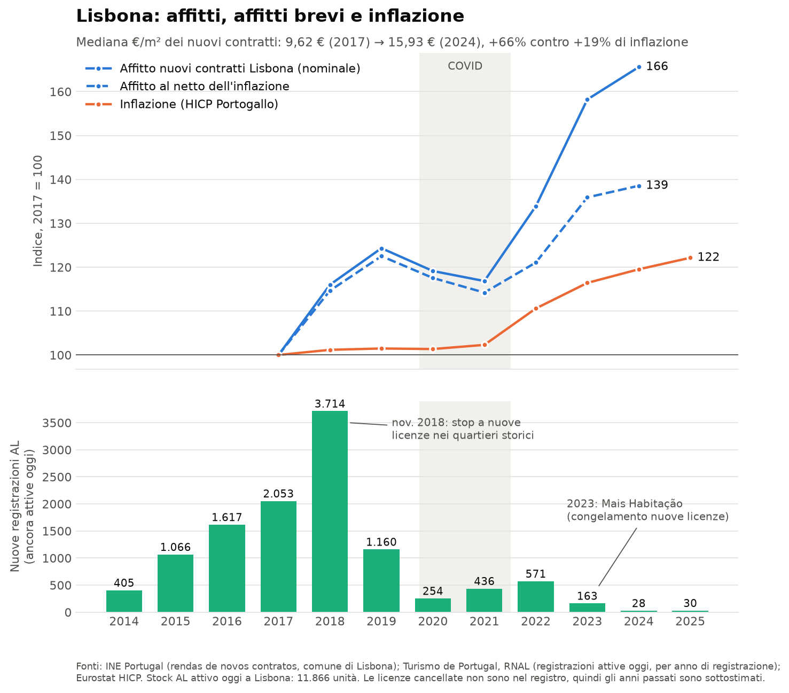

# Lisbona: affitti vs affitti brevi vs inflazione

`python plot_lisbon_rents.py` scarica i dati RNAL ed Eurostat e rigenera `lisbon_data.csv` e il PNG.

| Serie | Fonte |
|---|---|
| Affitti (mediana €/m², nuovi contratti, comune di Lisbona) | INE Portugal, indicatori 0009631 / 0012600 (trascritti: il sito INE blocca le richieste automatiche) |
| Affitti brevi (registrazioni Alojamento Local per anno) | Turismo de Portugal, API RNAL |
| Inflazione (HICP Portogallo, media annua) | Eurostat `prc_hicp_aind` |

## Come leggerlo

- **2017→2024:** affitti +66% nominali, +39% al netto dell'inflazione (inflazione +19%).
- **2014–2019:** le registrazioni di AL esplodono (picco 2018) e gli affitti salgono del 24% in due anni.
- **2020–2021:** con il COVID gli AL restano vuoti, molti tornano sul mercato tradizionale e gli affitti **scendono**. È l'indizio più forte a favore della tesi.
- **2022–2024:** gli affitti crescono più che mai, ma le nuove licenze AL sono quasi ferme (blocco 2018, Mais Habitação 2023). Questa fase si spiega con altri fattori: inflazione, tassi dei mutui, immigrazione e nomadi digitali, poca costruzione nuova.

In sintesi, i dati sono **coerenti** con un forte contributo degli affitti brevi alla crisi, soprattutto nella fase 2015–2019, ma una correlazione non basta a **dimostrare** che l'abbiano causata da soli.

## Limiti

- Il registro RNAL contiene solo le licenze **attive oggi**, quindi lo stock degli anni passati è sottostimato, e il calo recente sembra più netto di quanto sia stato.
- La serie INE sugli affitti comunali parte dal 2017, quindi non copre l'inizio del boom degli AL.
- L'HICP è nazionale e non specifico di Lisbona.
